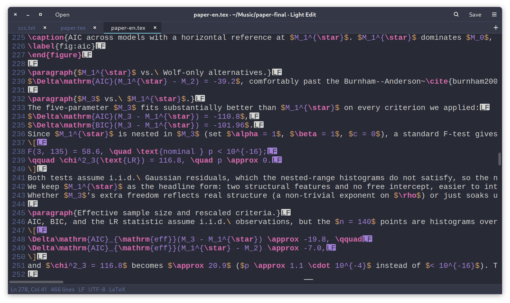
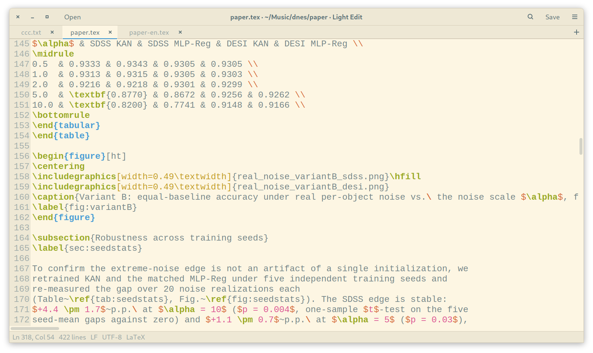
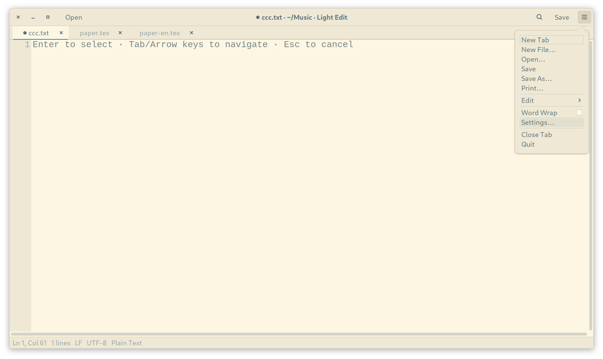
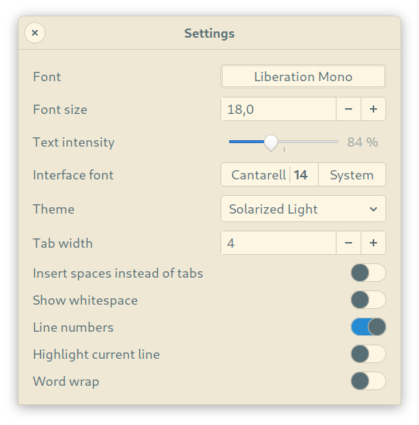

# Light Edit


A fast, lightweight text editor for Linux with tabs. It is built for stability,
speed and careful memory use, and it works with UTF‑8 text only.

The application is written in pure C17 on GTK 3. Editing is done by
[Scintilla](https://www.scintilla.org/) with [Lexilla](https://www.scintilla.org/Lexilla.html)
for syntax highlighting; the first build downloads both, checks their SHA‑256
and links them statically.

Author: **krse** · License: **MIT**

## Screenshots





<p>
  
  
</p>

## Features

**Files and tabs**

* Tabs with file names, drag to reorder, middle click to close
* The same file is never opened twice; Light Edit switches to its tab instead
* Open tabs are remembered between runs, with caret and scroll position
* At start only the visible tab is read, the others load when first selected
* New file (creates it on disk), open, save, save as, print
* Files changed on disk are reloaded automatically; with unsaved edits you are asked first
* A single running instance: `light-edit file.txt` opens a tab in the existing window
* Drag and drop files onto the editor

**UTF‑8 and safe saving**

* Files are read in 1 MiB chunks and checked as valid UTF‑8 while reading;
  other encodings are refused with the exact byte offset of the problem
* A UTF‑8 BOM is removed, LF, CRLF and CR line endings are kept as found
* Atomic save: a temporary file is written, synced to disk and renamed over the
  original, keeping its permissions and owner and following symlinks
* The save writes straight from the editor's buffer, without a copy

**Editing**

* Undo and redo, cut, copy, paste, select all, duplicate line
* Multiple carets and rectangular selection
* Find and replace with match case, whole word and regular expressions
* All matches are highlighted in the text and marked on the vertical scrollbar
* Replace all is a single undo step
* Go to line
* Syntax highlighting for C, C++, JavaScript/TypeScript, Java, Go, Rust, Python,
  Shell, JSON, HTML, XML, CSS, Makefile, YAML, Markdown, INI/TOML, Diff,
  LaTeX/TeX and Assembly (NASM/Intel and GNU as)

**Look and settings**

* 10 themes that colour the whole window, not only the text:
  Light, Dark, Solarized Light, Solarized Dark, Monokai, Gruvbox Dark, Nord,
  Dracula, Tokyo Night, Catppuccin Mocha
* Editor font and size; Ctrl + mouse wheel changes the size quickly
* Interface font and size, or the desktop's own
* Text intensity: lighter text below 100 %, heavier strokes above it
* Tab width, spaces or tabs, visible whitespace, line numbers,
  current line highlight, word wrap

## Build

Dependencies on Debian or Ubuntu:

```sh
sudo apt install build-essential libgtk-3-dev curl
```

The editing libraries are not stored in this repository; see
[Scintilla and Lexilla](#scintilla-and-lexilla) below.

Build and run:

```sh
make            # release build: build/release/light-edit
make debug      # debug build with AddressSanitizer and UBSan
make distclean  # also removes the downloaded libraries
make run
```

Install for the current user (binary, icon and menu entry):

```sh
make install                  # into ~/.local
make install PREFIX=/usr/local
make uninstall
```

### Scintilla and Lexilla

The first `make` downloads the two libraries automatically. To fetch them
on their own, for example before going offline:

```sh
make vendor
```

What happens:

1. `curl` downloads the pinned releases:
   * https://www.scintilla.org/scintilla567.tgz (Scintilla 5.6.7)
   * https://www.scintilla.org/lexilla554.tgz (Lexilla 5.5.4)
2. Each archive is checked with `sha256sum`; a wrong checksum stops the build.
3. They are unpacked into `vendor/scintilla` and `vendor/lexilla`
   (ignored by git) and built as static libraries.

Later builds use the unpacked copies and need no network.

**Without network access:** download both archives on another machine,
put them into `vendor/`, then run:

```sh
cd vendor
sha256sum scintilla567.tgz lexilla554.tgz   # compare with the Makefile
tar -xzf scintilla567.tgz && tar -xzf lexilla554.tgz
touch scintilla/.extracted lexilla/.extracted
cd .. && make
```

**Changing versions:** the versions and SHA‑256 checksums are set at the top
of the `Makefile` (`SCI_VER`, `LEX_VER`, `SCI_SHA`, `LEX_SHA`). After changing
them run `make distclean && make`.

## Keyboard shortcuts

| Action | Keys |
|---|---|
| New tab | Ctrl+N, Ctrl+T |
| New file | Ctrl+Alt+N |
| Open | Ctrl+O |
| Save / Save as | Ctrl+S / Ctrl+Shift+S |
| Print | Ctrl+P |
| Close tab | Ctrl+W |
| Next / previous tab | Ctrl+Page Down / Ctrl+Page Up, Ctrl+Tab |
| Undo / Redo | Ctrl+Z / Ctrl+Shift+Z, Ctrl+Y |
| Duplicate line | Ctrl+D |
| Find / Replace | Ctrl+F / Ctrl+H |
| Next / previous match | F3 / Shift+F3, Enter / Shift+Enter in the find field |
| Replace all | Ctrl+Enter in the replace field |
| Go to line | Ctrl+G |
| Font size | Ctrl + mouse wheel, Ctrl+Plus, Ctrl+Minus, Ctrl+0 |
| Settings | Ctrl+Comma |
| Quit | Ctrl+Q |

## Files

| Path | Content |
|---|---|
| `~/.config/light-edit/settings.ini` | Settings |
| `~/.config/light-edit/session.ini` | Open tabs with caret and scroll position |

## Source layout

| File | Purpose |
|---|---|
| `src/main.c` | Application start, single instance, icon |
| `src/window.c` | Window, tabs, menu, actions, dialogs, session, reload on change |
| `src/doc.c` | One document per tab, owned by its Scintilla widget |
| `src/fileio.c` | Chunked UTF‑8 loading and atomic saving |
| `src/search.c` | Find and replace bar, highlights, scrollbar marks |
| `src/lang.c` | File type detection, lexers, keywords, styles |
| `src/theme.c` | Colour themes |
| `src/ui_theme.c` | Theme and interface font for the GTK widgets |
| `src/settings.c` | Loading and saving settings |
| `src/prefs.c` | Settings dialog |
| `src/print.c` | Printing with syntax colours and page header |

## Memory and stability

* Each tab's data is freed together with its editor widget, so closing a tab
  cannot leak memory or free it twice
* A failed reload keeps the text you already have
* No background threads and no file watchers: changes on disk are checked with
  one `stat()` per file when the window gets focus
* Large files are styled in idle time, so opening them does not block

## License

Light Edit is released under the MIT License, see [LICENSE](LICENSE).

Scintilla and Lexilla are © Neil Hodgson and are distributed under their own
permissive license, see `License.txt` in `vendor/scintilla` and
`vendor/lexilla` after the first build.
